# Teaching a forecasting model a fashion store's season: fine-tuning t0-gamma with LoRA

*Ohad Bachner, Sizo AI · version of 2026-11-04 (first draft 2026-10-26)*

> **A living paper.** This is the current version, and it will be updated.
> We keep running tests, and each new round, test or comparison will be
> added here with its date. Numbers in this version are for round 14T.
> Next update: the comparison with other models on the full test (section 6).

## 1. Summary

**Buying the right quantity is one of the hardest problems in fashion retail.**
A store buys each product colour months ahead, often once a season. How many
units it will sell depends on many small factors: the time of year, sales and
discounts, which sizes are still in stock, the other colours of the same
model, the category, and how old the product is. Buy too few and you lose
sales. Buy too many and you sell at a markdown.

To use all these factors, the usual answer has been **regression models**
(for example gradient-boosted trees) built on hand-made features. Over the
last two years, **time-series foundation models** arrived. They are large
models pre-trained on millions of series that can forecast with no training at
all.

We compared several of these time-series models on real store data. We chose
one, **t0-gamma**, and fine-tuned it on our stores with LoRA, a small add-on
that trains about 4% of the model's weights. We chose it for three reasons:
- it has an open licence;
- it accepts many inputs;
- once it was given a "sold out" flag, it tied the best untrained model.

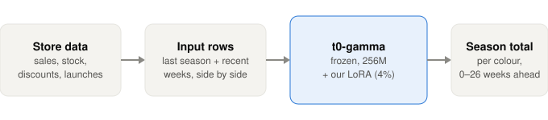

*Figure 1. How our model works. The store's weekly data goes in as rows next to each other; t0-gamma stays frozen and only our small LoRA add-on is trained.*

These results have not been published before.

**Our model.** One set of LoRA weights on top of t0-gamma, trained on the
history of 7 stores up to 30 November 2025. It forecasts the season total of
each product colour, from 26 weeks before the season up to its first day.
We trained it in many rounds and kept one, **round 14T** (section 5). Every
result in this paper is for these weights.

**How we got there.** Our first rounds forecast only from the first day of
the season and were tested on old good sellers. They taught us the recipe: a
"sold out" flag, a loss that scores the season total, and few strong inputs.
Then we saw that old good sellers are not the season, and that a buy plan is
made weeks ahead. So the later rounds forecast up to 26 weeks ahead and were
tested on every colour, new ones included. Round 14T did best (section 5).

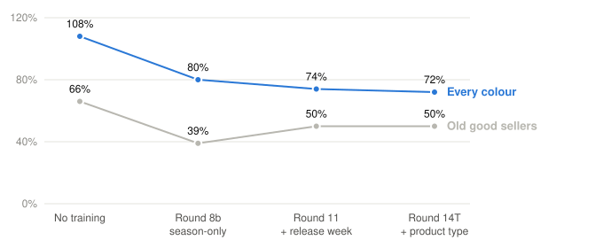

*Figure 2. Error by round, lower is better. Blue: every colour of Spring and Summer 2026. Grey: only the old good sellers. The round that looked best on old good sellers (8b) was not the best on every colour.*

**Two tests, and why their numbers differ.** We used two tests, and they
are very different. Their error numbers can't be compared with each other.

| | Old test | Full test |
|---|---|---|
| Used for | the early rounds | round 14T and every round from 8 on |
| Which colours | good sellers only: at least half a year of sales, at least 20 units in the last 26 weeks | every colour in stock for at least half the season |
| How many | 223 colours in 2025 (to choose), 136 in 2026 (to check) | 4,826 colour seasons, Spring and Summer 2026 |
| New colours | none | 2,698 (56%) |
| When the forecast is made | the first day of the season | 0, 4, 8, 13 and 26 weeks before |
| How hard | easy: long, steady history | hard: launches, no history, forecasts months ahead |
| Typical error | 40–50% | 70–110% |

The same model scores much worse on the full test because the cases are
harder, not because the model got worse. Round 14T scores 50% on old good
sellers and 72% on every colour. We moved to the full test because it is what
a store really buys: in 2026, 72% of units came from colours first sold after
September 2025, and none of them were in the old test.

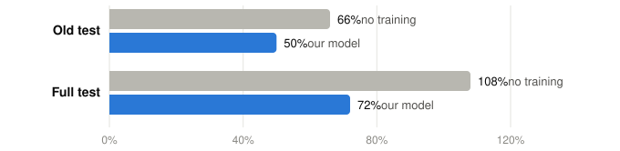

*Figure 3. The same two models on the two tests. Grey: t0-gamma with no training. Blue: our model (round 14T). The old test is easier for both; on both, training helps.*

**The result.** On every colour of Spring and Summer 2026, fine-tuning cut
the error of t0-gamma from 108% to 72% (section 6). On the old good-seller
test, an earlier LoRA round also beat TimesFM, Timestral and LightGBM
(42.0% vs 45.8–49.2%).

| | All colours | Old colours | New colours |
|---|---|---|---|
| t0-gamma, no training | 108% (+23%) | 146% (+96%) | 93% (−7%) |
| **Our model (round 14T)** | **72% (−25%)** | **78% (−22%)** | **70% (−27%)** |

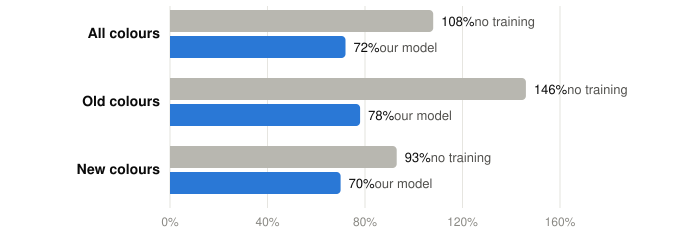

*Figure 4. Error on every colour, Spring and Summer 2026, lower is better. Grey: t0-gamma with no training. Blue: our model (round 14T).*

**Three takeaways**
1. **Fine-tuning is worth a lot.** Training cut the error from 108% to 72%.
   Untrained t0-gamma about doubles the forecast for old colours (+96%).
2. **What the store already knows helps most.** The biggest gains came from
   facts the merchant has in advance: the week a colour goes on sale, and the
   product type (taken from the title when the store left it empty).
3. **Test on every colour.** The round that was best on old good sellers
   (39%) was clearly worse on every colour (80%; section 5).

**Words used in this paper**

| Word | Meaning |
|---|---|
| Colour season | one product colour in one store season; the unit we forecast |
| Forecast date | the day the forecast is made; "8 weeks before" = 8 weeks before the season starts |
| Demand | what would have sold with stock on the shelf: weekly sales ÷ the share of the week in stock |
| Error | how far off the forecasts are, summed: Σ\|forecast − demand\| ÷ Σ demand. Lower is better |
| Bias | whether forecasts are too high (+) or too low (−) in total |
| No training (zero-shot) | the public t0-gamma model, used as it comes |
| LoRA | a small add-on trained on our stores; the big model stays as it is |
| Round | one training run of the add-on; each round is a new set of weights |
| Quantile | a point of the forecast range: the 10% quantile means a 10% chance of selling less |
| Pinball loss | the standard score for quantiles, used in training |
| Stand-in | for weeks before a colour existed, the sales of its siblings or category, scaled to one colour |
| Release week | the week a colour goes on sale; the merchant plans it in advance |
| Old / new colour | new = first sold within the 26 weeks before the season, or during it |

## 2. The problem

Forecasting how much a product will sell has many moving parts. In fashion,
five things make it harder.

**1. Every colour is its own product.** The same model in two colours can sell
very differently. One colour sells out in two weeks, while another stays on
the shelf. A forecast per product name mixes them, and the error is too big.
So we forecast each **product colour** on its own.

**2. Sizes decide the sales.** Each colour comes in several sizes, and one or
two of them carry most of the sales. When a key size sells out, the whole
colour sells much less, even with the other sizes in stock. When it is
restocked, sales come back.

In one store we found 87 colours where the best size ran out while the other
sizes were still in stock:

| | |
|---|---|
| The best size's share of sales (median) | 41% |
| Sales we'd expect if only that size's sales were lost | about 59% of normal |
| Sales measured right after it ran out (7 clean cases) | **22–29% of normal** |

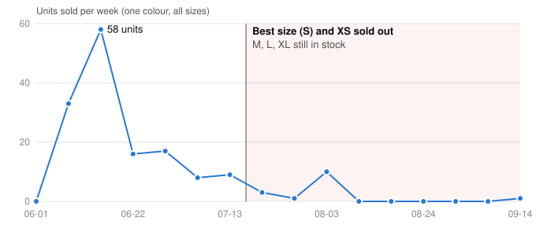

*Figure 5. One colour in one store, weekly units across all sizes. Once the two smallest sizes sold out, sales fell to almost zero, even though three sizes were still in stock.*

So a model has to know which sizes are strong and when each one is in or out
of stock. Sales in a week with a stock-out are not the real demand; they are
only a lower bound.

**3. Every store is different.** Stores plan by seasons, and each store has its own
seasons. In our data a season runs from two months to six months, and the
start dates differ from store to store (section 3). Some
stores grow mostly by launching new products, while others sell the same
classics every year.

| | All 7 stores | Range by store |
|---|---|---|
| Share of season sales from products launched that season | 39% | 2% – 54% |
| Units of repeat products vs the same season last year | 0.33× | 0.07× – 0.66× |

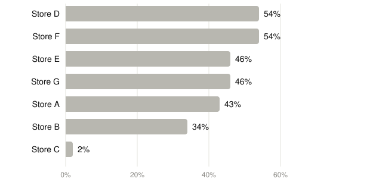

*Figure 6. Share of a season's sales that came from products launched in that season, by store.*

**4. Many signals matter at once.** These include discounts, restocks, stock on
hand, the other colours of the same model, the category, the product's age and
the time of year. A model has to read all of them together.

**5. The signals are connected to each other, like a graph.** One reason
leads to another. For example:
- Only the leftover sizes of a colour remain.
- So the store puts that colour on sale.
- A holiday is coming, so the sale is timed for it.
- Sales jump, but only in the sizes that are left, and then stop.

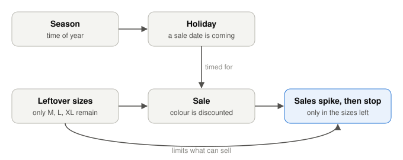

*Figure 7. The reasons behind one sales week, linked as a graph.*

Seen one signal at a time, each of these looks like noise. Together they
explain the week. This is why at Sizo we model a store as a **graph** of
connected facts, a "brain": discounts link to holidays, holidays to seasons,
and seasons to the sizes in stock. We then check whether each chain of reasons
makes sense. In this study the forecasting model gets all these signals side by
side and learns the links from the data itself.

**Why untrained models struggle.** A foundation model used "zero-shot" has
never seen a fashion store. Even when it gets the same rows as our model, it
doesn't know what a sold-out week, a launch week or a sale week means here.
- When a product sold out, its past sales look low, and a launch week looks
  like any other week. On 2026, untrained t0-gamma about doubled the forecast
  for old colours (+96%).
- New products have no history at all. Our test includes them, and so
  does our model's training (sections 3 and 4).

## 3. Data and scoring

**Data.** We used 7 online fashion stores on Shopify, called Store A–G here.
For every product colour and size we have, each week:
- units sold;
- the share of the week it was in stock;
- the stock at the end of the week;
- discounts and restocks.

The history starts in January 2024.

**A case** is one product colour in one store season. The model forecasts the
total units for the whole season. It forecasts 0, 4, 8, 13 and 26 weeks before
the season starts, each time using only data from before that date.

**Seasons** come from each store's own settings:

| Store | Seasons | Length |
|---|---|---|
| A, C, F | Spring, Summer, Fall, Winter (starting Mar, Jun, Sep, Dec) | 3 months each |
| B | Spring (Feb), Summer (Apr), Fall (Sep), Winter (Dec) | 2–5 months |
| D | Spring (Mar), Summer (Jun) | 3 months each |
| E | Summer (Mar), Winter (Sep) | 6 months each |
| G | Spring (Mar), Summer (Jun), Fall (mid-Sep), Winter (Dec) | 2½–3½ months |

**The test: every colour.** Spring and Summer 2026 in all 7 stores.
- 4,826 colour seasons: 2,128 colours that were already selling and 2,698 new
  ones (first sold in the 26 weeks before the season, or during it).
- Each colour must be in stock at least half the season, because demand can't
  be seen when the colour isn't on the shelf.
- New colours are most of the season (section 1), so they must be in the test.

**The old test: old good sellers.** The early rounds were built and checked
on good sellers only. Section 1 compares the two tests, including round 14T
on 130 such colours from the test seasons.

**Four kinds of colour.** What the model knows about a colour on the first
day of the season decides how hard it is. We split the test into four kinds:

| Kind | Colour seasons | Share of demand | What the model has | The problem |
|---|---|---|---|---|
| **1. Launched in the season** | 878 | 37% | nothing of its own: no sales, no last season | it must guess the level from the category; launches often sell most in one release week |
| **2. Started shortly before** | 1,820 | 34% | a few weeks of sales, no last season | a few weeks give a noisy share, so its siblings' last season is scaled up or down by a shaky number |
| **3. Old, but no sales last season** | 596 | 6% | history, but last season's row is all zero | it skipped or came back; zero last season says "sell nothing", which is wrong |
| **4. Old, sold last season** | 1,532 | 22% | its own last season and recent weeks | the most information, but this season is not last season: drops, discounts and stock change the level |

Two more groups cut across these four:
- **Seasonal items** (swimwear, coats, jackets, knitwear): 452 colour
  seasons, 16% of demand. They sell only in their season, often in one launch
  week (section 5), so the weeks before the forecast date say little.
- **No product type in the store:** 1,112 colour seasons, 12% of demand. One
  store left 94% of its product types empty. Without a type, a colour's
  category is one big mixed group, and its stand-in is wrong. Our model takes
  the type from the title (section 4).

"Launched" means the colour's first week in our data is in the season;
"started shortly before" means within the 26 weeks before it. Section 6 shows
the error for each kind.

**What counts as the real number.** Stock-outs during the season cut sales
short, so units sold would punish a forecast for demand the store couldn't
serve. We score against **demand** instead: each week's sales ÷ how much of
the colour was in stock that week. Each size counts by its share of sales,
and the divisor is never below 0.3.

**Error and bias.** Both are summed over all cases and forecast dates, so big
sellers count more, as they do in a buy plan.
- Error = Σ |forecast − demand| ÷ Σ demand. 0% is perfect.
- Bias = Σ (forecast − demand) ÷ Σ demand. Below zero means too low.

**What the model never saw.** Training data ends on 30 November 2025, and the
test seasons start in 2026. But we compared rounds on these same test
seasons (with only a small Winter 2025 check), so the final score is a
little optimistic (section 8).

**Training windows.** A training window is one product colour at one forecast
date: last year's same season and the 8 weeks before the date as history,
and the season itself as the target. Windows come from all 7 stores, with
forecast dates 0, 4, 8, 13, 20 and 26 weeks before the season. They include
colours that were not on sale yet at the forecast date but launched during
the season, so the model learns launches too.

## 4. The model

**The base: t0-gamma.** A time-series foundation model from The Forecasting
Company: 256M parameters, open licence (Apache-2.0). For each week ahead it
gives 21 quantiles, from "1% chance of selling less" to "99%". Besides the
sales row, it reads extra rows next to it, such as stock or discounts, so it
can use the store's signals.

**The add-on: LoRA.** We keep t0-gamma frozen and train small extra matrices
(rank 32) in 96 of its layers: the attention and feed-forward layers of all
24 blocks. That is 11.0M trained weights, about 4% of the model. The saved
add-on loads on top of the public model.

**What it sees.** The history is short and seasonal: last year's same season,
then the 8 weeks before the forecast date. Next to the sales row:

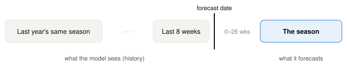

*Figure 8. The input window. The model sees last year's same season and the 8 weeks before the forecast date, and forecasts the season 0 to 26 weeks later.*

| Row | What it tells the model |
|---|---|
| Sold out | the colour was in stock less than half the week |
| Key size out | a strong size was out of stock |
| Stand-in | this week's sales are a stand-in, not the colour's own (below) |
| Part | last year's season, the recent weeks, or the season being forecast |
| Category level | the category's sales vs its yearly average (for the season: the same weeks last year) |
| Release week | the weeks the colour goes on sale (the merchant plans these) |
| Stock | units on hand |
| Discount | share of sales on discount |

**Last season, or the siblings.** What the model sees for last year's season
depends on the colour:
1. **The colour sold last season:** its own sales from last season.
2. **The colour is new since then, but already selling:** its siblings'
   sales from last season, flagged as a stand-in. First choice: the same
   style's other colours. If they didn't sell, colours with the same size
   curve in its category. Else, the whole category. The siblings are scaled
   to this colour by its share of their sales in recent weeks.
3. **The colour hasn't sold at all yet:** with no share to scale by, it gets
   the category's sales ÷ the number of colours selling in that category.

The product type comes from the store, or from the title when the store left
it empty.

**How it learns (the loss).** Each training window is scored three ways at
once:
- **week by week:** each weekly quantile against what sold (pinball loss).
  Weeks with no stock are left out, because they say nothing about demand.
  Only in the category's strong weeks does a sold-out week still count, as
  "demand was at least what sold".
- **the season total:** the sum of the weeks against the season's total.
- **the forecast itself:** the season total of the mean forecast should match
  what sold.

All three are divided by the window's average sales, so big and small
sellers count about the same. Training ran 1,500 steps (learning rate 3e-4,
32 windows per step).

**From 21 quantiles to one number.** The forecast is the mean of the
quantiles, summed over the season's weeks.

## 5. Choosing the round

We trained the t0-gamma LoRA in many rounds. Each round is a new set of
weights. We scored every round from round 8 on the same full test and kept
**one: round 14T, the round with the lowest error on all colours.** It is
"our model" everywhere in this paper.

| Round | What changed | All colours | Old colours | New colours | Old good sellers |
|---|---|---|---|---|---|
| — | t0-gamma, no training (same input) | 108% (+23%) | 146% (+96%) | 93% (−7%) | 66% |
| 8b | Season-only input, siblings as the stand-in | 80% (−48%) | 80% (−23%) | 79% (−58%) | 39% |
| 11 | + release week, new colours in training | 74% (−27%) | 78% (−27%) | 73% (−27%) | 50% |
| 12 | 11 + last year's launches as the stand-in for new colours | 80% (+4%) | 85% | 78% | — |
| 13A | 11 + launch windows 3× as often, demand in sold-out weeks | 78% (−13%) | 82% | 76% | 46% |
| 13B | 13A + last year's launches as the stand-in | 81% (+3%) | 83% | 80% | 51% |
| **14T** | **11 + empty product types filled from the title** | **72% (−25%)** | **78% (−22%)** | **70% (−27%)** | **50%** |
| 14C | 14T + the style's other colours as the stand-in for new colours | 76% (−18%) | 80% | 74% | 52% |

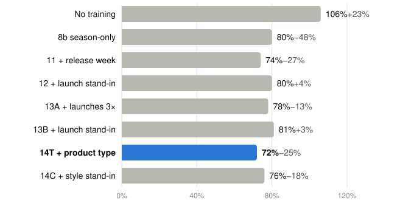

*Figure 9. Every round on the full test (4,826 colour seasons, all forecast dates), with its bias. Lower is better. Round 14T has the lowest error.*

**Why not the best round on old good sellers?** Round 8b scored 39% there,
but 80% on all colours. Old good sellers are not the season (section 1). A buy plan is made
for every colour, so we choose on every colour.

**What round 14T kept from each step:**
1. **The release week (round 11).** Most swimwear sold in one launch week
   (the week of 2 March 2026, 86–99% of some colours' spring units). Nothing
   in the sales history announces it. Marking the weeks a colour goes on
   sale, which the merchant plans ahead, fixed swimwear.
2. **Training on new colours (round 11).** Windows for colours that weren't
   on sale yet at the forecast date taught the model to launch them.
3. **Filling empty product types (round 14T).** One store left 94% of its
   product types empty, and another 9%. All such products formed one mixed
   "category", so a new colour got a tiny share of it. Taking the type from
   the title (top, tee, dress, pants…; cards, perfume and samples stay empty)
   lowered their error from 84% to 73% and changed nothing else.

**Before round 8.** The first rounds forecast only from the first day of the
season and were built on old good sellers, so they used other inputs and
another test, and we don't compare them here. They taught us the recipe that
round 14T still uses:
- a "sold out" flag works better than hiding sold-out weeks;
- the loss must include the season total, not only single weeks;
- fewer, stronger inputs beat many;
- the newest data matters most.

They also showed why we had to move on: asked weeks before the season, they
flattened it (for one store's swimwear, winter came out at about 18× last
winter and spring about 40% too low).

## 6. Results

All numbers in this section are for our model, on the full test.

**Overall.** Every product colour in the 7 stores that was in stock for at
least half of Spring or Summer 2026: 4,826 colour seasons, 2,698 of them new
colours. Nothing from 2026 was used in training.

| | All colours | Old colours | New colours | Old good sellers* |
|---|---|---|---|---|
| t0-gamma, no training | 108% (+23%) | 146% (+96%) | 93% (−7%) | 66% (+47%) |
| **Our model** | **72% (−25%)** | **78% (−22%)** | **70% (−27%)** | **50%** |

*Error = Σ|forecast − actual| ÷ Σ actual, over all colours and forecast dates,
lower is better. Bias = how far the total is too high (+) or too low (−).
\*130 colours that had sold well for at least half a year, forecast on the
first day of the season.*

**How sure is the gain?** We resampled the 4,826 colour seasons 2,000 times
(bootstrap). Our model beat untrained t0-gamma in every resample: the gain is
36 points, with a 90% range of 33 to 40 points.

**Against other models.** We have compared the other models only on the old
good-seller test: 136 colours from 2026 seasons, forecast on the first day of
the season. On that test the t0-gamma LoRA was an earlier round (forecast
from the season start, 9 input groups), not round 14T. Round 14T and the
other models have not yet been scored side by side on the full test; that
run is under way.

| Model | 2025 error (bias) | 2026 error (bias) |
|---|---|---|
| **t0-gamma + LoRA (earlier round)** | 42.2%* (−8%) | **42.0% (−4%)** |
| TimesFM (no training) | 47.7% (−6%) | 45.8% (−14%) |
| t0-gamma, no training | 47.9% (−14%) | 45.9% (−23%) |
| Timestral 209M (no training) | 44.9% (−11%) | 47.2% (−15%) |
| LightGBM (trained on our data) | 44.1% (−15%) | 49.2% (−21%) |

\*In-sample: that round was trained on 2025. All choices were made on 2025
(223 colours); 2026 was scored once.

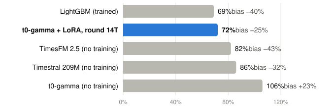

*Figure 10. The old good-seller test (136 colours, 2026), lower is better. Blue: the earlier t0-gamma LoRA round. Bias: how far the total was too high (+) or too low (−).*

- The LoRA round beat untrained t0-gamma in 95% of bootstrap resamples
  (−4.0 points, 90% range −8.0 to +0.1).
- Added to an equal average of 8 forecasts, it lowered that average's error
  from 41.8% to 41.4%.
- What we don't know yet: whether round 14T keeps this lead. On 130 of these
  old good sellers it scores 50%, but the other models were not run on that
  exact set.

**By forecast date.** The error grows slowly as the forecast is made earlier:

| Weeks before the season | 0 | 4 | 8 | 13 | 26 |
|---|---|---|---|---|---|
| Error | 67% | 70% | 73% | 74% | 77% |

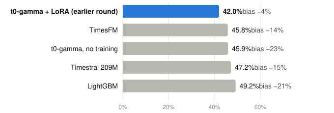

*Figure 11. Our model's error by how many weeks before the season the forecast is made. Forecasting half a year ahead costs 10 points.*

**By season.**

| Season | No training | Our model |
|---|---|---|
| Spring 2026 | 122% (+39%) | 81% (−18%) |
| Summer 2026 | 101% (+15%) | 68% (−29%) |

**By store.** Our model is better than no training in every store.

| Store | Colour seasons | Share of demand | No training | Our model |
|---|---|---|---|---|
| A | 2,162 | 58% | 116% (+34%) | 77% (−31%) |
| B | 766 | 13% | 120% (+36%) | 69% (−9%) |
| C | 50 | 1% | 117% (+92%) | 71% (−6%) |
| D | 851 | 8% | 103% (−21%) | 77% (−37%) |
| E | 363 | 17% | 71% (−4%) | 56% (−19%) |
| F | 368 | 1% | 141% (+24%) | 82% (−26%) |
| G | 266 | 2% | 86% (+2%) | 68% (+7%) |

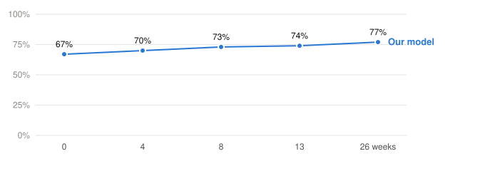

*Figure 12. Error by store. Grey: no training. Blue: our model. Store A carries 58% of all demand, so it weighs most in the total.*

**By kind of colour** (the kinds are defined in section 3).

| Kind | Share of demand | No training | Our model |
|---|---|---|---|
| 1. Launched in the season | 37% | 71% (−46%) | **62% (−34%)** |
| 2. Started shortly before | 34% | 116% (+36%) | 77% (−19%) |
| 3. Old, but no sales last season | 6% | 198% (+129%) | 96% (−13%) |
| 4. Old, sold last season | 22% | 132% (+87%) | 73% (−25%) |
| Seasonal items | 16% | 136% (+94%) | 68% (−13%) |
| Accessories (clips, bags, caps) | 18% | 86% | 78% (−44%) |
| No product type in the store | 12% | 114% (−7%) | 73% (−26%) |

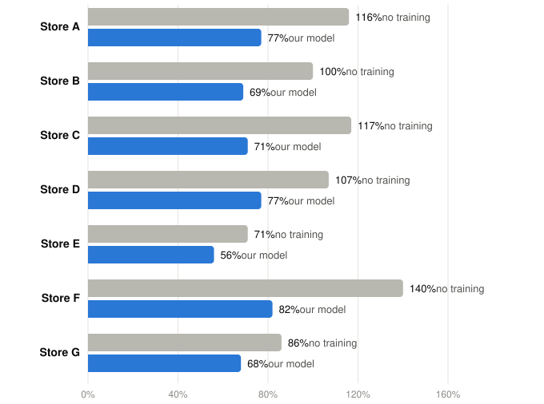

*Figure 13. Error by kind of colour. Grey: no training. Blue: our model. Training helps every kind; it helps most where untrained t0-gamma copies last season.*

What this shows:
- **The hardest kind is 3, old colours with no sales last season (96%).**
  Untrained t0-gamma doubles them (+129%); our model is closer but still far.
  A zero last season tells the model little about this one.
- **Launched colours are the easiest for our model (62%),** even with no
  history. They are big and they start in a known release week. But they
  stay too low (−34%): the category stand-in gives each new colour an
  average share, and a hit sells far more.
- **Untrained t0-gamma copies last season.** Where it sees a last season,
  its own or a stand-in (kinds 2–4 and seasonal items), it forecasts far too
  high (+36% to +129%);
  where it doesn't (kind 1), far too low (−46%).
- **Seasonal items** go from 136% to 68%, the biggest gain, thanks to the
  release week. Inside them, old seasonal colours that sold last season are
  still at about 105%: last year's launch level doesn't repeat.
- **No product type** ends at 73%, about the same as colours with a type
  (72%), once the type is taken from the title.
- **The best case** is an old, all-year colour with a type that sold last
  season: 1,187 colour seasons (19% of demand) at 69% (−28%).

**Swimwear.** For spring swimwear, demand was 7,458 units. Our model forecast
7,773 (+4%); untrained t0-gamma forecast 18,301.

**What is left.** The model is still too low overall (−25%), most of all on
accessories (−44%) and new colours (−27%). A new colour whose style suddenly
takes off is the hardest case: nothing in last season says it will.

## 7. What didn't work

The rounds after 11 that lost (section 5):
- **Launch windows 3× as often (13A):** it lifted pants and tees but
  overshot new swimwear (+26%).
- **Last year's launches, or the style's other colours, as the stand-in for
  a new colour (12, 13B, 14C):** it helped clips (76% → 62%), but some new
  swim tops and dresses were forecast 5–30× too high.
- **Stock-corrected demand in the colour's own sold-out weeks (13A):** no gain.

**Why new colours stay too low.** t0-gamma rescales every input row by its
own average, so a fixed attribute (category, price tier, style) carries no
signal as its own row. The only way to tell the model a new colour's level is
through the sales row itself (the stand-in). A model that keeps fixed product
attributes attached to each series is the most direct next step.

## 8. Caveats
- **One year only.** The test is two seasons, Spring and Summer 2026. A
  different year, with other launches and other weather, may score
  differently.
- **Chosen on the test seasons.** We compared rounds on these same seasons,
  with only a small Winter 2025 check. So the 72% is a little optimistic;
  the next season is the honest test.
- **One big store.** Store A is 58% of all demand, so the total leans on it.
  Stores C, F and G are small (1–2% each), so their numbers move a lot.
- **Other models only on the old test.** TimesFM, Timestral and LightGBM were
  compared with an earlier LoRA round on 136 old good sellers, not with round
  14T on the full test (section 6).
- **Still too low.** The model under-forecasts by 25% overall, 27% on new
  colours and 44% on accessories. A buy plan built on it needs that in mind.
- **A rough launch date.** "New" means first sold within our data, which
  starts in January 2024. A product first sold before then can look new.

## 9. Ideas for the future
- **Score the other models on the same test.** Run TimesFM, Timestral and
  LightGBM on the 4,826 colour seasons, so round 14T has a fair comparison.
- **Keep product facts next to each series.** t0-gamma rescales every row on
  its own, so a fixed fact (category, price tier, style) carries no signal.
  A model that keeps these facts attached could give new colours the right
  level.
- **Fix the under-forecast.** Test a simple correction for the −25% bias,
  chosen on a season before the test, and check that it holds.
- **More stores in training,** so no single store sets the pattern.
- **Per-store add-ons** for the biggest stores, on top of the shared one.
- **A real promo calendar.** Planned sales and their dates, from the store,
  as a known-ahead row like the release week.
- **The true launch date** from the store, instead of the first sale in our
  data.

## Appendix: settings of round 14T

| Setting | Value |
|---|---|
| Base model | `theforecastingcompany/t0-gamma` (256M parameters, 21 quantiles), library `tfc-t0` 0.6.0 |
| LoRA | rank 32, alpha 64, on 96 linear layers (attention and feed-forward of 24 blocks); 11,010,048 trained weights |
| Optimizer | AdamW, learning rate 3e-4, no weight decay, gradient clip 1.0 |
| Training | 1,500 steps, 32 windows per step, on CPU |
| Training data | 7 stores, targets ending before 1 Dec 2025 |
| Forecast dates in training | 0, 4, 8, 13, 20 and 26 weeks before the season |
| History | last year's same season + the 8 weeks before the forecast date |
| Rows | sales (or stand-in), sold out, key size out, stand-in flag, part, category level, release week, stock, discount share |
| Sold out | in stock less than half the week |
| Loss | weekly pinball on in-stock weeks; sold-out weeks one-sided (weight 0.5) only in the category's strong weeks; season-total pinball; season total of the mean (Huber); ÷ the window's average sales |
| Readout | mean of the 21 quantiles, × 1.0, summed over the season |
| Test | Spring and Summer 2026, 4,826 colour seasons in stock ≥ 50% of the season, forecast 0/4/8/13/26 weeks ahead, against stock-corrected demand |
| Software | PyTorch 2.8.0 |
